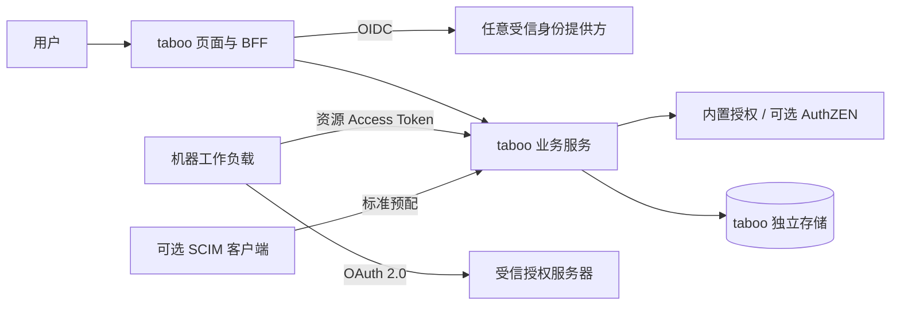

# taboo 标准身份联邦与多租户改造计划

- 编号：KTI-PLAN；版本：0.5；日期：2026-09-27；状态：P0 实现及公开本地验收收口，分支合并记录见任务结果。
- 改造对象：开源 taboo 项目；源码核对基线 `d5724d3`。
- 本版替代此前面向单一 Identity 工程的 v0.1 计划：改为开放标准、提供方无关的产品设计。
- 架构基准：[OpenVault 功能与详细设计](../../doc/OpenVault_密钥管理平台_功能与详细设计.md)。历史实施检查点见 [实施记录](../design/standard-identity-federation-m0.zh-CN.md)，以及 [存储、加密与投递记录](../design/standard-identity-storage.zh-CN.md)。当前完成范围以 [P0 验收记录](../design/standard-federation-acceptance.zh-CN.md) 为准。

## 1. 产品目标和不可违反的边界

taboo 是能独立构建、部署和使用的开源密钥与凭据管理产品。外部身份系统负责其用户认证和身份生命周期；taboo 负责自己的组织、成员准入、项目、环境、秘密及业务授权。通过公开标准接入多个身份提供方，可按需增加标准目录预配和外部授权服务。

这里的密钥管理首期指秘密保管与分发，不扩大为通用 Encrypt/Sign、PKI 或 HSM 服务。

1. 公共代码、构建、镜像、测试、文档及 SDK 均不依赖任何闭源仓库、私有包、内部数据表或私有控制面 API。
2. 核心模型不采用特定厂商的 Realm、应用安装、主用户 ID、角色前缀等对象；提供方切换通过信任登记和映射完成。
3. 本地账号与机器身份仍是独立产品的合法能力。管理员可为指定组织强制外部身份登录；一旦强制，不能回退本地账号或接受旧会话绕过策略。来源显式区分，不采用“外部验证失败后尝试本地”的路径。
4. 保留 taboo 独立 UI、后端和数据所有权。其他平台可以链接到 taboo；首期不共享平台 Cookie、不嵌入私有前端壳层、不搬迁业务代码。
5. 外部 IdP 不必支持目录同步、机器 Token、外部授权或所有退出扩展。按公开的能力画像启用功能，缺失能力不能被伪装成已支持。
6. 公共 CI 必须在没有任何私有仓库权限的环境中通过。私有产品的部署和联调材料留在其所属工程，不能成为开源发布的前置依赖。

## 2. 标准协议与实施范围

| 能力 | 采用协议/规范 | 本期定位 |
| --- | --- | --- |
| 人员登录 | [OpenID Connect Core 1.0](https://openid.net/specs/openid-connect-core-1_0.html)、[Discovery](https://openid.net/specs/openid-connect-discovery-1_0.html)、[PKCE RFC 7636](https://www.rfc-editor.org/rfc/rfc7636.html) | P0 必做：Code + S256，服务端 BFF；不要求所有可选 OIDC 扩展 |
| 安全基线 | [OAuth 2.0 Security BCP，RFC 9700](https://www.rfc-editor.org/rfc/rfc9700.html) | P0：可信 issuer、精确回调、请求关联及严格 Token 校验 |
| 外部机器访问 | [OAuth 2.0 RFC 6749](https://www.rfc-editor.org/rfc/rfc6749.html)、[元数据 RFC 8414](https://www.rfc-editor.org/rfc/rfc8414.html) | P0：`client_credentials`；Client 认证使用双方支持且已登记的方法 |
| API Token 验证 | [JWT Access Token Profile，RFC 9068](https://www.rfc-editor.org/rfc/rfc9068.html) 或 [Token Introspection，RFC 7662](https://www.rfc-editor.org/rfc/rfc7662.html) | P0：两种明确验证画像；不能仅因为 Token 是 JWT 就视为符合 9068；opaque Token 不在本地解析 |
| 资源选择 | [Resource Indicators，RFC 8707](https://www.rfc-editor.org/rfc/rfc8707.html) | 能力支持时发送 `resource`；不支持时使用服务端已登记的正确 audience，不能关闭 audience 校验 |
| 退出 | [RP-Initiated Logout](https://openid.net/specs/openid-connect-rpinitiated-1_0.html)、[Back-Channel Logout](https://openid.net/specs/openid-connect-backchannel-1_0.html) | 本地退出 P0 必做；RP 退出按发现能力启用；Back-Channel 为 P1 |
| 用户/组预配 | [SCIM 2.0，RFC 7643](https://www.rfc-editor.org/rfc/rfc7643.html) / [RFC 7644](https://www.rfc-editor.org/rfc/rfc7644.html) | P1 可选：taboo 作为 SCIM 服务提供方接收入站预配；不要求每个 IdP 都能出站预配 |
| 外部授权决策 | [OpenID AuthZEN Authorization API 1.0](https://openid.net/specs/authorization-api-1_0.html) | P1 可选：标准客户端；默认使用 taboo 内置授权，不依赖任何特定 PDP |

“开放标准”与“某个系统采用开源许可证”是不同概念；对接依据是协议、能力声明和互操作证据。OIDC 不统一规定业务组织、租户、组和角色字段的含义；OAuth scope 也不等同于项目或秘密的完整业务权限。

协议可选并不意味着所选安全策略可被降级：启用在线检查、强认证或外部 PDP 后，缺失必要能力应阻止启用，运行时错误应拒绝受保护操作。

## 3. 通用模型与职责

| 对象/模块 | 定义与边界 |
| --- | --- |
| `Organization` | taboo 自有组织及数据隔离边界，保留本地稳定 ID；不等同外部 issuer 或外部租户 |
| `IdentityConnection` | 管理员登记的 issuer、Client、凭据引用、回调、能力及 Claim 映射；可按组织绑定，同一 issuer 可服务多个组织 |
| `ExternalIdentity` | 经验证的 `(issuer, sub)` 引用；不按邮箱自动合并；pairwise sub 在不同 Client 下不假设相同，迁移/关联必须显式证明 |
| `Membership / Group / RoleAssignment` | taboo 业务准入与权限；来源可以是本地管理、受控 JIT 或 SCIM，每条来源和撤销责任明确 |
| `WorkloadBinding` | 把受信授权服务器验证的机器身份绑定到本地组织、项目/环境、允许 scope 和动作；subject/client 的对应关系按认证画像明确，不假设二者总相等 |
| `Project → Environment → Folder → Secret → Version` | 延续现有业务层次；其 ID、加密上下文和生命周期不依赖任何外部平台 |
| `AuthorizationProvider` | 内置 RBAC/资源限制为默认；可显式启用 AuthZEN。无论来源如何，taboo 始终执行组织隔离、对象归属及安全不变量 |
| `Audit / Outbox / DeliveryTask` | 记录本地组织、认证来源、主体引用、动作、版本与关联 ID；不保存明文秘密或 Token |

外部用户认证由所选 IdP 负责；本地账号由 taboo 自己负责。taboo 可以消费外部组/角色信息映射权限，但不把某家 IdP 的权限目录当成运行前提，也不向上游回写密码或覆盖其用户生命周期。

### 3.1 组织与身份映射

优先支持两种无厂商依赖的方式：管理员将连接绑定到一个组织；或同一连接的已验证身份通过本地成员关系进入多个组织。外部组织 Claim 映射属于可选配置，只有明确允许的 Claim 来源和值才能匹配已登记组织；不能仅因 Token 中出现某个值就自动建组织或授予权限。

登录前的组织入口只选择认证连接，不授予成员资格。会话按请求绑定目标组织并重新校验准入，组织切换清空秘密明文且不能改变另一标签页的写入目标。

JIT 默认关闭，或仅允许已有邀请/显式准入规则；不得把组织身份源的任意用户默认设为 owner。组/角色 Claim 并无通用必填字段，映射缺失、失效和撤销行为必须配置并可审计。组来源、外部身份和 SCIM 资源 ID 之间的关联也不能靠 email、displayName 或 `externalId=sub` 的假设建立。

### 3.2 登录与 Token 验证

OIDC BFF 负责 state、nonce、S256、issuer、audience/azp、签名算法白名单、时效、一次性回调和服务端 Token 存储；UserInfo 使用时核对 sub 一致。浏览器只持有 taboo 的 HttpOnly 会话，写入检查 CSRF。Discovery 仅从已登记 issuer 获取，不能信任请求中任意 URL；控制网络目标、超时、重定向和错误脱敏。

外部机器先在可信授权服务器获取针对 taboo 资源的 Token，taboo 作为资源服务器验证它。JWT 画像验证 9068 所需字段和 Token 类型；内省画像通过受保护的标准端点验证 active、有效期及必要上下文，缺少 audience/机器身份/scope 证据时不能仅凭 `active=true` 放行。认证通过后仍需本地 WorkloadBinding 和业务权限。

本地机器凭据可继续存在，但拥有独立的认证来源、密钥、Token 验证规则和开关。新增外部机器接入不默认轮换或升级已有机器权限，也不接受用户 ID Token 作为 API 凭据。

### 3.3 授权、强认证与撤权

本地授权始终可独立工作：元数据读取、明文读取、写入、回滚、删除、导出、项目管理、授权管理和审计读取分离。新画像不采用 write 隐含 reveal；旧授权升级先盘点并明确迁移。高风险人工操作使用配置要求的近期认证证明；`acr/amr` 值的保证级别由可信连接画像解释，不把字符串或一次 SSO 登录自动视为 MFA。

外部 AuthZEN 启用后，明确将主体、动作、资源和上下文映射为标准请求。策略数据和授权目录管理不由 AuthZEN 自动解决。固定部署选择及策略版本，不在 PDP 故障时切回本地 ALLOW；本地隔离检查也不能被外部 ALLOW 覆盖。

区分两类撤权：

- **taboo 本地撤权**：成员/工作负载绑定/角色被停用后，下一次经过授权检查的请求拒绝，所有缓存按版本失效；声明已完成授权的在途操作边界。
- **上游状态变化**：仅靠离线 Token 或本地网页登录会话无法承诺即时感知。公开提供 `BOUNDED` 与 `ONLINE_REQUIRED` 两种策略画像，分别列出最长会话/Token/授权缓存时限，或要求每次受保护访问的在线状态证明。画像选择必须显式，严格模式不得自动降级。

在线内省也不能凭规范名称推断一定关联用户禁用、旧 Token、组织成员或角色变化：逐项验证提供方语义。SCIM、Back-Channel 与 IdP 登录会话变化的语义不同；事件是否送达、同步时延以及本地兜底截止时间分别记录。未实现对应能力的 IdP 仍可用于已满足条件的基础登录，不得标称完整即时撤权。

对于 reveal/导出等敏感操作，启用前必须选择并展示可用的保证画像。缺少当前策略要求的强认证或在线检查能力时拒绝操作，而不是用过期 ALLOW 或未经验证的 Claim 替代。不存在双方都支持的画像时，该连接不能用于该类操作。

## 4. 架构与开源交付

拟定模块按协议命名，如 `internal/federation/oidc`、`internal/oauthresource`、`internal/provisioning/scim`、`internal/authorization/authzen`；路径由 KTI-00 核实后冻结。禁止建立以闭源产品命名的核心适配器、引用其 `internal` 包或复制其私有 DTO。

PostgreSQL 作为多租户生产部署画像；SQLite 保留独立/小型部署用途。存储选择与是否接 OIDC 相互独立，不人为规定 OIDC 必须使用 PostgreSQL。数据库隔离、专用 KEK/DEK、AAD、密钥缓存等全部使用 taboo 本地组织和对象 ID。

公共文档与测试只使用公开标准、脱敏例子和可获得的开源依赖。选定 Keycloak 作为第一家真实开源互操作对象，版本/镜像摘要在实施时固定；测试方法参考其[官方 OIDC 端点说明](https://www.keycloak.org/securing-apps/oidc-layers)。再使用可复现的独立协议夹具测试无 groups、无租户 Claim、不同 sub、opaque Token、能力缺失等情况。夹具不是第二家真实产品兼容性证明。

## 5. 工作包与依赖

KTI-00 至 KTI-11 的实现和本地公开验收已收口，证据与真实部署边界见 [P0 验收记录](../design/standard-federation-acceptance.zh-CN.md)。保留 KTI-00 至 KTI-11 编号但按开放标准重新定义，v0.1 的 ID-01/ID-02/ID-03 私有依赖全部退出公共关键路径。

| 编号 | 主改动位置 | 交付物 | 前置 | 完成门槛 |
| --- | --- | --- | --- | --- |
| KTI-00 | `docs/design`、`api`、公开联调夹具 | 协议/能力画像、对象和权限矩阵、映射与撤权语义、Claim 来源规则、OpenAPI；同步架构基准；真实开源 OP 最小试验 | 计划批准 | 不需要闭源工程可登录；无专有 Claim 也能建立受控成员关系；能力缺失行为有明确契约 |
| KTI-01 | `internal/store`、仓储/迁移 | PostgreSQL 画像、连接/外部身份/成员来源/工作负载绑定、复合约束和 RLS；保留 SQLite | 00 | 组织隔离、新建/升级/失败回滚、连接池上下文和旧模式回归通过 |
| KTI-02 | `internal/oidc`、`auth`、`config`、`server` | 通用 OIDC BFF、配置/发现/JWKS、会话/CSRF、刷新与退出、显式本地/外部登录策略 | 00、01 | 真实开源 OP 流程和协议负例通过；不按 email 合并；强制外部登录的组织无本地回退 |
| KTI-03 | `internal/rbac`、`auth`、`org`、`project` | taboo 内置组织/项目/环境权限、受控 JIT 和 Claim 映射、来源保护、认证强度及撤权画像 | 01、02 | 外部 IdP 无权限目录仍能使用；write/reveal 分离；本地撤权生效；上游撤权时限可测量且没有越权映射 |
| KTI-04 | `internal/crypto`、`secret`、`folder` | 专用 KEK/DEK、版本化密文/AAD/缓存、新旧格式读与迁移、CAS 和幂等 | 01；业务验收依赖 03 | 错组织/对象/版本解密拒绝；并发与响应丢失安全；更换 IdP 不需要改变秘密所属组织或重加密 |
| KTI-05 | `internal/audit`、`outbox`、`events`、worker | 事务审计与 outbox、消费者任务持久化确认、重试/去重/死信、多 worker 恢复 | 01、04 | 审计失败回滚；发布与消费者落库窗口不丢任务；重复投递安全；无明文日志 |
| KTI-06 | OAuth 资源验证模块、`internal/identity` | 外部 client_credentials 消费、9068 JWT/7662 内省画像、WorkloadBinding、来源区分及本地机器兼容 | 00、01、03、04 | 真实机器调用；错误 issuer/aud/类型/scope 拒绝；opaque 不被猜测解析；按选定画像验证禁用和过期 |
| KTI-07 | `apps/web/src`、OpenAPI/类型生成 | 通用身份连接/组织选择、原生组织与权限管理、秘密/版本/reveal/审计、能力和撤权保证展示 | 02 至 05；机器页依赖 06 | 不出现私有产品必填字段/跳转；普通成员可用；停用/403/会话过期/窄屏/键盘/多标签行为真实验收 |
| KTI-08 | `packages/sdk-go`、`apps/cli`、`apps/mcp` | 标准 OAuth 配置、Token 获取/缓存、组织目标、机器 get/run/MCP；本地身份兼容和迁移指南 | 06、API 冻结 | 三类实际消费者正负测试；不依赖私有 SDK；缓存按可信配置隔离；不泄露 Token |
| KTI-09 | 迁移命令、`docs/runbooks` | 旧组织/身份/权限映射、存储/密文迁移、IdP 更换与解绑、根密钥恢复、消费者切换 | 01、03 至 06、08 | 受控副本计数/关联/解密/回退演练；更换或停用连接不删除秘密；无未批准自授权 |
| KTI-10 | `.github/workflows/ci.yml`、测试矩阵 | 无私有依赖的 Go/SDK/MCP/前端检查、Keycloak 真联调、独立协议负例、原模式回归 | 随 01 至 08 推进 | 全新公共 checkout 可重现；无私有凭据/镜像；双组织/双 issuer 及 Claim 缺失验收，无必要套件静默跳过 |
| KTI-11 | Docker/Helm、手册、发行说明 | 可选身份连接、PostgreSQL 运行画像、外部引导凭据、探针、worker、安全策略及能力说明 | 09、10 | 独立部署/升级/恢复证据；IdP/PDP 故障符合所选策略；版本和兼容范围清晰 |

机器方式的 CLI/SDK/MCP 是 P0。个人 CLI 浏览器登录、SAML SP、Device Authorization Grant 等不因“使用开放标准”自动进入本期，应在明确注册画像与需求后另排工作包。

### 5.1 可选扩展工作包

| 编号 | 内容 | 依赖及验收 |
| --- | --- | --- |
| KTI-12（P1） | SCIM 2.0 入站 Users/Groups、ServiceProviderConfig/Schemas/ResourceTypes、来源隔离和停用 | 01、03、10；使用标准 SCIM 客户端验收；token/connector 绑定组织；本地与 SCIM 来源不互相覆盖；认证关联单独验证 |
| KTI-13（P1） | AuthZEN 1.0 标准授权客户端、资源/主体映射及策略配置 | 03、10；真实标准服务或明确标注的协议夹具；外部 deny/故障不回退；不把非标准 PDP 包装成已通过互操作 |
| KTI-14（P1） | Back-Channel Logout 与会话关联 | 02、10；验证 logout Token、issuer/aud/events/sid/sub/重放和目标会话范围；不声明它等同权限变更通知 |

P1 有独立验收，不是 P0 发布前置，也不默认已获得实施授权。

## 6. 阶段和完成定义

| 阶段 | 范围 | 退出条件 |
| --- | --- | --- |
| M0 标准与样板 | KTI-00 | 通用契约、撤权画像、Keycloak 样板；不含闭源专有依赖 |
| M1 基础服务 | KTI-01 至 05 | 本地/外部认证、内置授权、双组织数据与加密隔离、审计事务验证 |
| M2 可用产品 | KTI-06 至 08，持续 KTI-10 | 页面与三类机器消费者在公开环境跑通；JWT/opaque 画像分别验证 |
| M3 发布准备 | KTI-09 至 11 | 迁移/恢复/公开 CI/部署指南齐全，第三方可独立重现 |
| M4 实际接入 | 按每个部署的通用配置和投运安排 | 逐个提供方记录支持范围及真实环境证据；私有提供方未完成不阻塞公共 P0 发布 |
| M5 标准扩展 | 经单独安排的 KTI-12 至 14 | 各自协议/失败/来源边界验收；不由 OIDC 成功推断 |

不先承诺工期；M0 后按通用协议适配、存储及存量规模估算。基础 P0 完成只代表本计划定义的标准画像，不能宣布所有 OIDC/OAuth 厂商、SCIM、AuthZEN 或外部 KMS 都兼容。

## 7. 关键验收矩阵

| 类别 | 必测场景 |
| --- | --- |
| 开源独立性 | 新环境没有任何私有仓库和凭据；依赖下载、编译、测试、制品和快速开始均可完成 |
| 通用登录 | 不提供 tenant/groups/roles 私有 Claim 的 OP；同 issuer 多组织、不同 issuer 同 sub、pairwise sub 和缺少 email |
| 协议安全 | 错误签名/issuer/aud/azp/state/nonce/PKCE、重复回调、错误 Token 类型、JWK 轮换、Discovery 非可信网络目标 |
| 授权 | 组织入口不等于准入；本地角色、映射来源和项目范围；write/reveal/export 分离；未知 Claim 和外部角色不自动提权 |
| 撤权 | 本地禁用的下次请求；上游禁用在 BOUNDED 时限内拒绝；ONLINE_REQUIRED 下 inactive/故障拒绝且不降级；不能只测“无法拿新 Token” |
| 机器 | 真实 client_credentials、正确 resource/aud、同名 Client 跨 issuer、opaque 内省、机器绑定撤销、用户 Token 混入机器路径 |
| 数据 | 列表/详情/历史/回滚/移动/导出/审计/worker 的跨组织 ID；RLS 与连接池复用；AAD 和密钥版本缓存 |
| 故障 | 审计失败、提交结果未知、重复更新、worker 崩溃/重复投递、IdP 不可用、根材料缺失；没有自动新建替代密钥 |
| UI | 无提供方专有必填字段；权限可解释；退出/切换组织清明文；多标签不误写；长内容/窄屏/键盘/焦点 |
| 可迁移 | 更换 IdP 只调整证明后的身份绑定；组织/项目/密文稳定；本地强制登录策略无旁路；旧审计来源保留 |

基线必须同时包含真实 Keycloak 与独立协议夹具；其他真实 IdP 兼容性按实测版本逐个登记。任何私有 Identity 的适配证明均作为该部署的附加证据，不充当公共唯一测试来源。

## 8. 迁移、恢复和原有能力

1. 先盘点元数据、身份来源、权限、真实消费者、根密钥来源及动态租约，不将明文导出进文档。
2. 保留原组织 ID、项目归属；外部身份逐个受控绑定。去除 email 自动关联，旧 owner/reveal 权限不得隐式传播到新外部身份。
3. SQLite→PostgreSQL 与身份提供方迁移可以分别进行；在受控副本上核对数据/版本/关联/解密和幂等重跑。
4. 默认采用计划内停写与单写切换，不擅自双写。新库已有写入后不能直接回到旧快照，须处理增量与版本配套。
5. 新认证来源的 Sync/Webhook/导出/动态租约等路径必须逐项授权适配；未适配路径不得接受该来源。保留独立模式的已授权功能，不能无通知关闭已有服务。
6. 动态数据库租约需完成回收交接或保留隔离回收任务，不能因为切换登录方式就停掉回收。
7. 备份集包括数据库、配置版本和真正使用的根材料，不只依赖本地 `master.key` 文件。协议凭据和根材料有外部可信引导来源。

自动凭据轮换、全部同步目标、动态凭据扩展、双人审批、外部 KMS/HSM/BYOK 仍为后续范围。秘密历史回滚不保证外部系统接受旧凭据。

## 9. 本次计划修订与实施纪律

本版删除了对单一提供方私有租户安装字段、规范用户 ID 格式、权限 Manifest、PEP 私有请求、Trust 包和私有机器内省扩展的公共依赖；不只是把适配器改名。保留多租户隔离、加密、审计、迁移与恢复要求。

用户已批准开始实施；首批修改位于 taboo 仓库并使用公开临时测试环境。按工作包交付，分别报告本地测试、公开 CI、互操作、部署和真实环境验收。可选 P1 与每个部署的提供方能力缺口另行跟踪。
